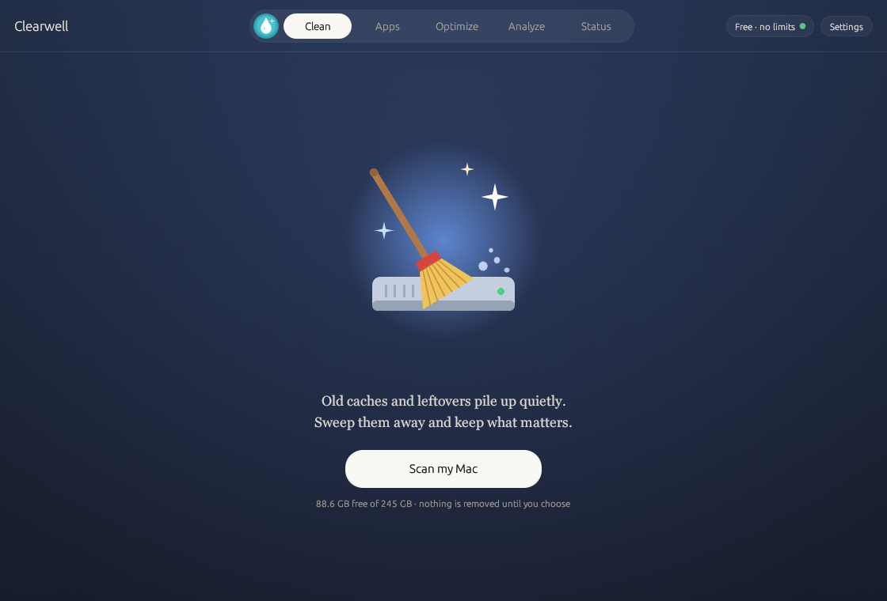
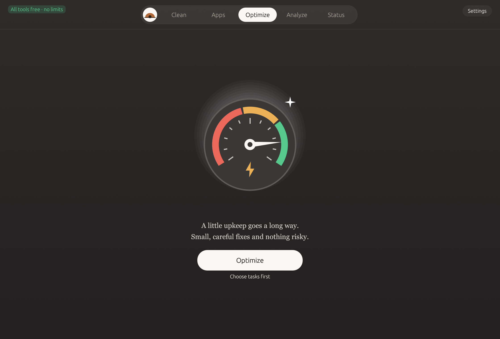

# CleanWell

A macOS cleanup and maintenance app with tools for cache cleanup, app removal, disk usage analysis, maintenance, and system health.

## Downloads

Download packaged builds from [Releases](https://github.com/HeyitsTayters/CleanWell-Releases/releases). Development builds are marked as prereleases. Source code and development records are maintained privately.

The current development build still displays **Clearwell** inside the app.

## Install

Download the macOS archive for your Mac, unzip it, and move `CleanWell.app` into Applications. Development builds are not notarized; macOS may require approval in System Settings → Privacy & Security. Only approve a build you trust. Review the selected items before running cleanup or maintenance.

## Screenshots

Clean screen from the existing development build:

Earlier maintenance screen preview (appearance may differ in current builds):

## Feedback

Report problems through this repository’s Issues. Include your macOS version and app version; remove personal paths and private information from screenshots or logs.
